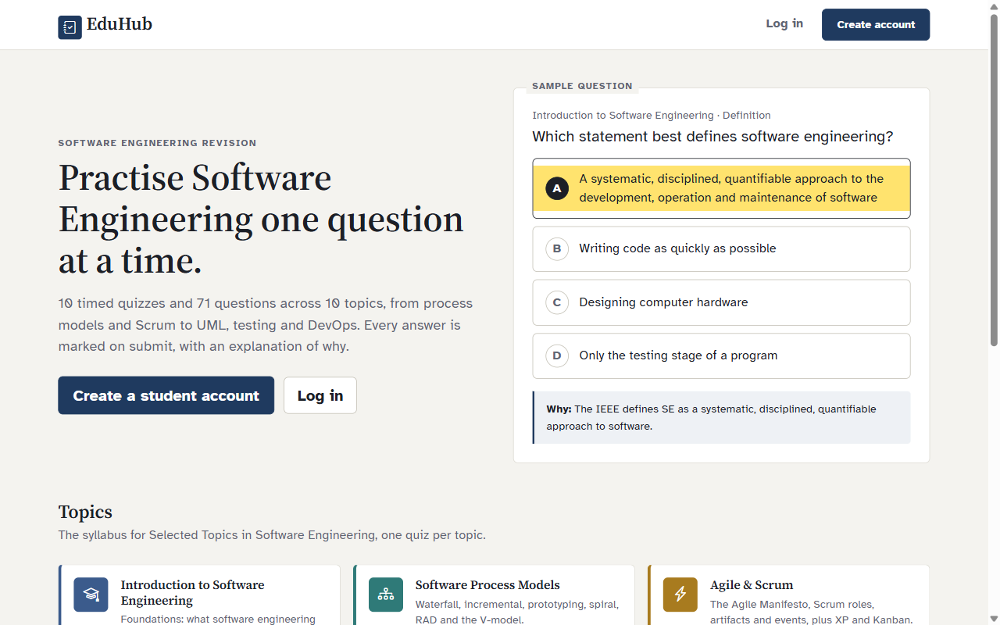
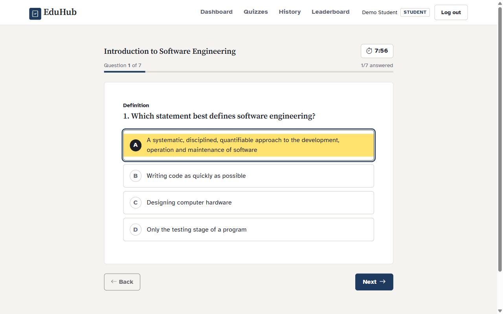
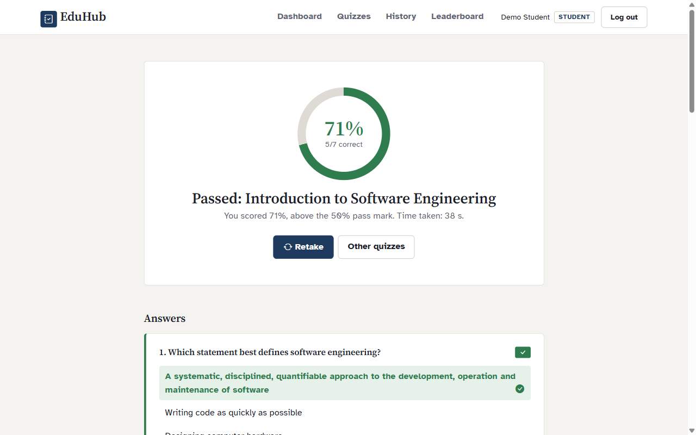

# EduHub

[](https://github.com/Miaoricle/eduhub/actions/workflows/ci.yml)

A Django quiz platform for Software Engineering students. Students take timed, auto-marked quizzes and see an explanation for every answer. Lecturers write the questions. Admins get an overview of how the platform is used.

I first built it for **ISB46803 Selected Topics in Software Engineering** at UniKL MIIT. This version reworks it: it fixes the security and correctness problems listed below, adds a test suite, and replaces the original design.



| Taking a quiz | Result with explanations |
| --- | --- |
|  |  |

## What it does

| Role | Can |
| --- | --- |
| **Student** | Take quizzes one question at a time with a countdown, see the score and an explanation for every answer, track history, appear on the leaderboard |
| **Lecturer** | Create quizzes (drafts until published), add, edit and delete questions with 2–4 options, see students' attempts and their answers |
| **Admin** | Overview with totals, average score, late submissions, attempts per day and per topic; full CRUD and role management in Django admin |

The question bank has 10 topics, 10 quizzes and 71 questions with explanations. It covers SE fundamentals, process models, Agile and Scrum, requirements, design and architecture, UML, testing, quality and maintenance, project management and estimation, and configuration management and DevOps.

## Run it

```bash
python -m venv .venv
. .venv/bin/activate          # Windows: .venv\Scripts\activate
pip install -r requirements.txt
python manage.py migrate
python manage.py seed_data    # question bank + demo accounts
python manage.py runserver
```

Then open http://127.0.0.1:8000. The demo accounts are created by `seed_data`. Use them for local testing only:

| Role | Username | Password |
| --- | --- | --- |
| Admin | `admin` | `admin123` |
| Lecturer | `lecturer` | `teach123` |
| Student | `student` | `learn123` (also `alice`, `bob`, `carol`) |

`python manage.py seed_data --fresh` resets the quiz data.

For anything beyond your own machine, set `DJANGO_DEBUG=0`, `DJANGO_SECRET_KEY` and `DJANGO_ALLOWED_HOSTS`. With debug off, the app refuses to start without a secret key.

## What changed from the coursework version

These were real problems in the original, and each fix has a test in [`quizzes/tests`](quizzes/tests/test_quiz_flow.py):

- **Anyone could register as a lecturer.** The sign-up form had a role dropdown, so a student could give themselves quiz-editing rights. Sign-up now always creates a student. Lecturers are promoted by an admin.
- **The timer could be bypassed.** The time taken was sent by the browser, the limit only existed in JavaScript, and a refresh restarted the clock. Now an attempt starts on the server when the quiz opens, and a refresh resumes the same attempt with the same deadline. Submissions after the limit plus a 30-second grace period are recorded but flagged as late.
- **The leaderboard could be farmed.** It added up raw scores, so retaking one easy quiz twenty times beat doing every quiz once. It now adds each student's best percentage per quiz, so every quiz is worth at most 100.
- **Editing a question rewrote history.** Choices were deleted and recreated, so past attempts lost track of which option a student had picked. Choices are now updated in place.
- **A question could have no correct answer,** for example if C was marked correct but left empty. The form now rejects that, and duplicate options too.
- **The admin's "average score" averaged raw points** across quizzes of different lengths. It's now an average percentage.
- **Smaller things:** submitting twice no longer creates a duplicate attempt, drafts are hidden from students, quiz authors can open their students' results, and the secret key moved out of the code into environment variables.

## How it's built

- **Django 6** with the standard Model–Template–View structure and SQLite.
- **Server-side marking.** Choices are checked against the question they belong to, so a forged form can't submit another question's correct option.
- **Attempts as a small state machine.** An attempt is *in progress* until it's submitted. Every statistic uses `Attempt.objects.completed()`, so abandoned attempts don't count.
- **Bootstrap 5** for layout, with a custom stylesheet ([`style.css`](quizzes/static/quizzes/style.css)): paper and ink colours, Source Serif 4 and Atkinson Hyperlegible type, and a highlighter mark on the selected answer.

```
eduhub/            settings (reads DJANGO_* environment variables), urls
quizzes/
  models.py        User (roles), Topic, Quiz, Question, Choice, Attempt, Answer
  views.py         per-role views, server-side timer and marking, leaderboard
  forms.py         sign-up, quiz and question forms with validation
  tests/           end-to-end tests through Django's test client
  management/commands/seed_data.py   the question bank and demo data
```

## Tests

```bash
python manage.py test
```

19 tests drive the app through HTTP as each role would. They cover permissions, marking, the server-side timer (using a frozen clock), leaderboard rules, question editing and that every page renders. CI also checks for missing migrations, runs the seed command on a fresh database, and confirms production settings won't start without a secret key.

## License

MIT
